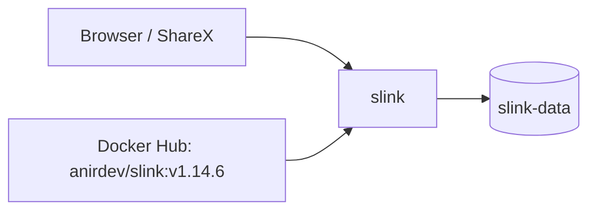

<div align="center">

# Slink on Render

Self-hosted image hosting and sharing. Upload images, share them with private or short links, organize them into collections, and upload from ShareX. This repo is the Blueprint. The app runs from the official [Slink](https://github.com/andrii-kryvoviaz/slink) image.

<p>
  <a href="https://render.com/deploy-template/api/github/start?template_repo=slink">
    
  </a>
</p>

<p>
  <a href="https://render.com">
    
  </a>
  <a href="https://github.com/andrii-kryvoviaz/slink">
    
  </a>
  <a href="https://github.com/andrii-kryvoviaz/slink/blob/main/LICENSE">
    
  </a>
</p>

</div>

## What This Template Shows

This repository does not contain the Slink source. The service pulls the official image from Docker Hub at a pinned version. To upgrade, change the tag in [`render.yaml`](./render.yaml) and push.

| Piece | Role |
| --- | --- |
| **[Slink](https://github.com/andrii-kryvoviaz/slink)** | Web app, API, image processing, and a built-in Redis queue in one container. |
| **`slink`** ([Web Service](https://render.com/docs/web-services)) | The app. |
| **`slink-data`** ([Persistent disk](https://render.com/docs/disks)) | SQLite databases, signing keys, and uploaded images, all under `/app`. |

## Architecture



### How It Works

1. Click **Deploy to Render**. The flow copies this repo into your GitHub account and applies [`render.yaml`](./render.yaml).
2. On Apply, enter `ADMIN_EMAIL`. Render creates the disk and generates `ADMIN_PASSWORD`.
3. On first boot, Slink generates its signing keys, creates its databases on the disk, and creates the `admin` account.
4. Sign in and upload.

| Resource | Type | Plan | Notes |
| --- | --- | --- | --- |
| `slink` | Web, image | Starter | Disk at `/app`, 5 GB. Health: `/api/health`. Single instance. |

Default region: **Oregon**.

### Render-specific settings

| Setting | Why |
| --- | --- |
| Disk at `/app` | Slink stores data in two fixed folders, `/app/var/data` and `/app/slink/images`. A Render service has one disk, and `/app` holds both. |
| Start command | The image gives the `frankenphp` binary a file capability so it can bind low ports. Render containers don't allow it, and the API fails with `Operation not permitted`. The start command replaces the binary with a plain copy, then runs Slink's normal entrypoint. Slink only binds port 8080, so nothing else changes. |
| `PORT=3000` | The web app listens on `PORT`. The API stays internal on 8080. |
| `ORIGIN` | The service's public URL. The web app rejects sign-ins and uploads from any other origin. |

## Quick Start

1. Click **Deploy to Render** above and enter `ADMIN_EMAIL`.
2. Wait until `slink` is **Live**.
3. Copy `ADMIN_PASSWORD` from the service's **Environment** page and sign in with `ADMIN_EMAIL`.
4. Upload an image and share it.

```bash
curl -fsS "https://<slink>.onrender.com/api/health"
```

## Configuration

| Variable | Source | Description |
| --- | --- | --- |
| `ADMIN_EMAIL` | Required | Admin email. The account is created on first boot. |
| `ADMIN_PASSWORD` | Generated | Admin password for the first sign-in. Change it in the UI afterward. |
| `ADMIN_USERNAME` | Blueprint | `admin`. |
| `ORIGIN` | Wired | The service's `RENDER_EXTERNAL_URL`. Update it after you add a custom domain. |
| `PORT` | Blueprint | `3000`. |
| Others | Optional | Registration, upload limits, S3 storage, and OIDC SSO. See [`.env.example`](./.env.example). |

Slink's defaults allow public sign-ups, but new accounts need admin approval. Anyone can browse public images on **Explore**. To change either, set `USER_ALLOW_REGISTRATION` or `USER_ALLOW_UNAUTHENTICATED_ACCESS` to `false`.

## Cost

Prices from [Render's pricing page](https://render.com/pricing).

| Resource | Approx. monthly |
| --- | ---: |
| `slink` (Starter) | $7 |
| 5 GB disk | $1.25 |
| **Total** | **~$8.25** |

Slink used about 300 MB of memory in testing. If you upload many large images at once, watch memory and move to Standard if it nears 512 MB. To store more images, increase the disk size, or set `STORAGE_PROVIDER=s3`.

## Troubleshooting

| Problem | Solution |
| --- | --- |
| Logs repeat `unable to exec frankenphp: Operation not permitted` | The start command is missing. Restore the `dockerCommand` in [`render.yaml`](./render.yaml). |
| Sign-in or upload fails with a cross-site or forbidden error | `ORIGIN` must be the URL in your browser. Update it after you add a custom domain. |
| Images or accounts disappear after a deploy | Confirm the disk is mounted at `/app`. |
| Deploy takes about a minute of downtime | Expected. A service with a disk stops the old instance before it starts the new one. |

## Project Structure

```
render.yaml       Blueprint. One image-backed web service with a disk.
README.md         This file
LICENSE           Wrapper license
.env.example      Value the deploy form asks for, and optional extras
```

## Learn More

- [Blueprint spec](https://render.com/docs/blueprint-spec)
- [Slink docs](https://docs.slinkapp.io)
- [Slink on GitHub](https://github.com/andrii-kryvoviaz/slink)

## License

[MIT](LICENSE) for this wrapper.

Slink is licensed under [AGPL-3.0](https://github.com/andrii-kryvoviaz/slink/blob/main/LICENSE). If you modify Slink and let others use it over a network, you must make your modified source available to them.
